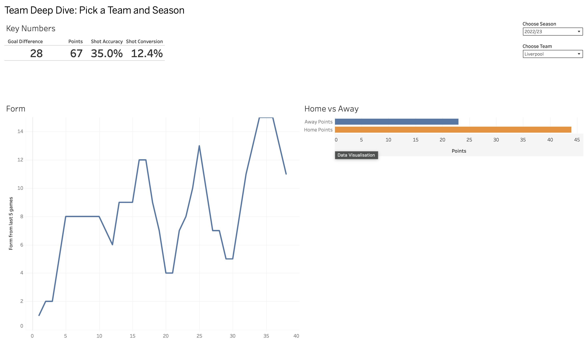
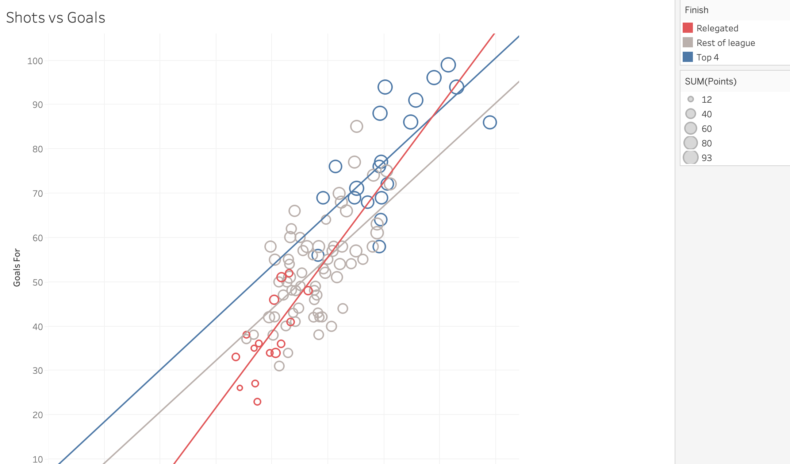
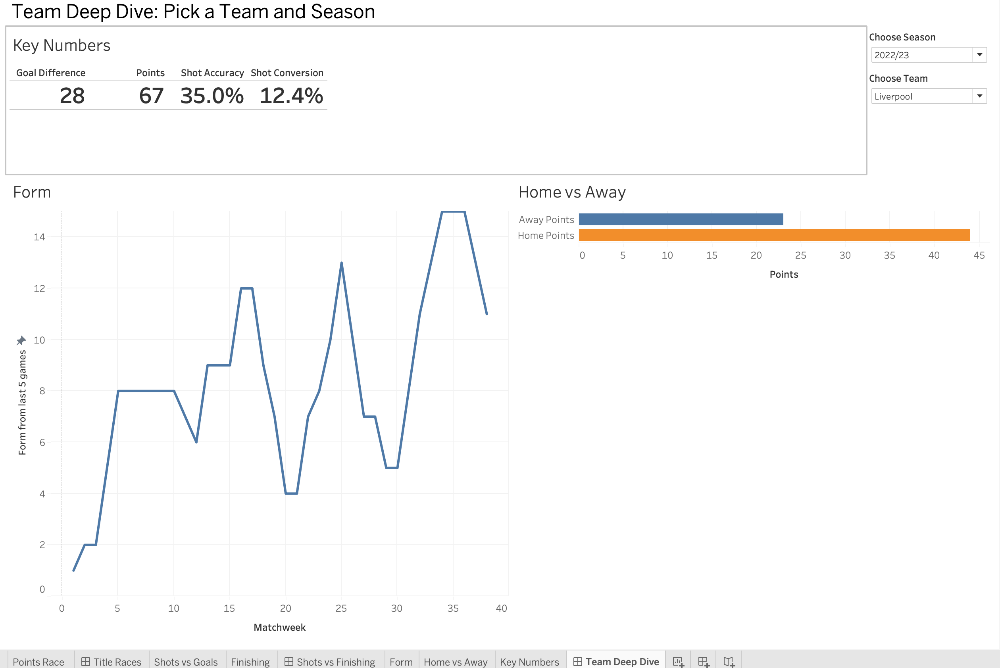

# Premier League Performance Dashboard

An interactive Tableau dashboard analysing five Premier League seasons (2021/22 to 2025/26) to answer one question:

> **What separates the top of the table from the rest: creating more chances, or finishing them better?**

**[View the live dashboard on Tableau Public](https://public.tableau.com/app/profile/samuel.kesse/viz/PremierLeaguePerformanceDashboard_17924513822770/TitleRaces)**

## Key finding

**Volume beats finishing.** My starting hypothesis was that top teams win by finishing their chances better. The data rejected it.

Across 100 team-seasons, league points track **shot volume** and **goals conceded** far more closely than **finishing quality**:

| Stat | Correlation with points |
|---|---|
| Goals conceded | **−0.85** |
| Shots on target | **0.84** |
| Shots | **0.83** |
| Shot conversion (goals per shot) | 0.65 |

The best teams don't just finish better. They create more chances and concede fewer goals.

*Correlation, not causation. Shot counts don't capture chance quality; expected goals (xG) data would refine this.*

## Dashboards

**1. Title Races:** league table and a week-by-week points race for any season.



**2. Shots vs Finishing:** every team-season plotted by shots and goals with a trend line, plus a finishing league table.



**3. Team Deep Dive:** pick any team and season to see key numbers, rolling 5-game form and home vs away points.



## How it was built

- **`prep_data.py`** (Python, pandas): cleans five seasons of raw match data (1,900 matches), reshapes home/away rows into one row per team per match, and calculates points, rolling form, shot conversion and home/away splits.
- **Tableau Public**: three linked dashboards using parameters to drive views across two data sources.

**Tools:** Python (pandas) · Tableau · Data: [football-data.co.uk](https://www.football-data.co.uk)

## Reproduce it

```
pip install pandas
# put E0_2122.csv ... E0_2526.csv from football-data.co.uk in data/
python prep_data.py
```
